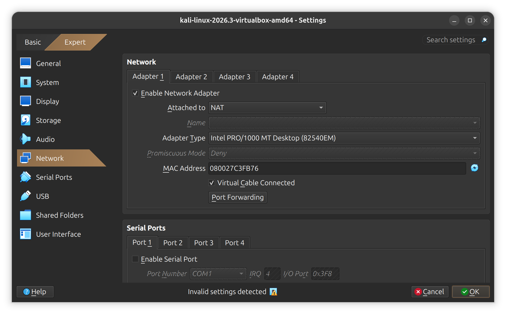
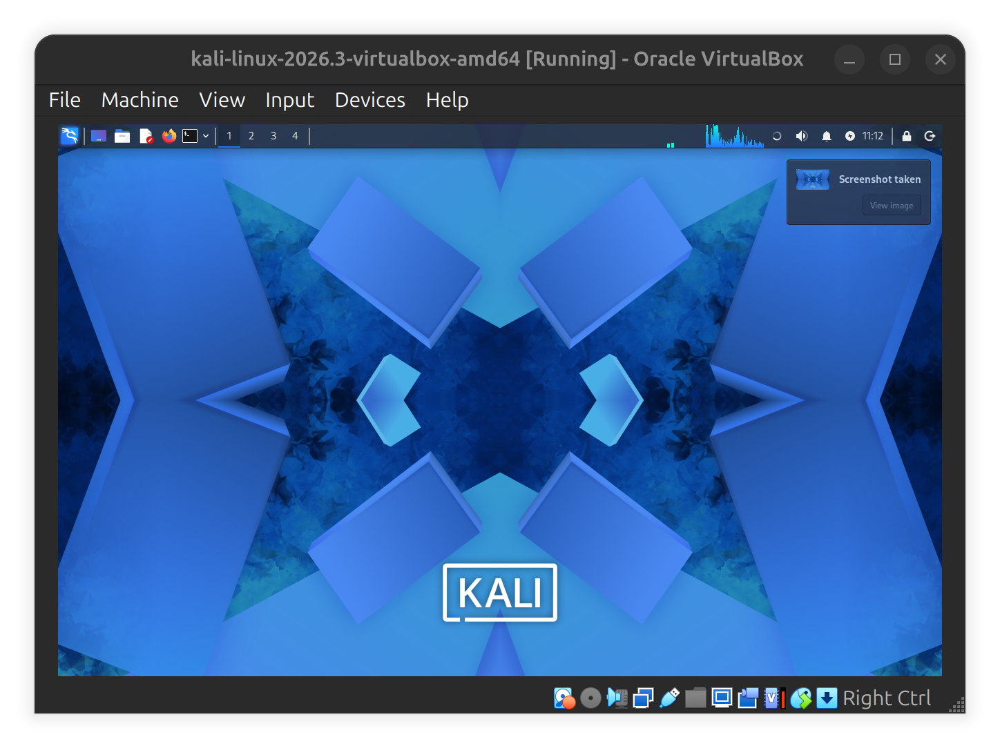

## networkwalks-B084l-week1-Cybersecurity-lab-setup
##🔐 Cybersecurity Lab Environment Setup

<div align="center">

## Building a virtual cybersecurity laboratory using VirtualBox and Kali Linux.

</div>

<p align="center">          </p>

---

## 📌  Project Overview

This project focuses on setting up a virtual cybersecurity and penetration-testing laboratory using Oracle VirtualBox and Kali Linux.

The purpose of the lab is to establish a controlled virtual environment where cybersecurity tools, network scanning, reconnaissance, vulnerability assessment, and other security-testing activities can be performed safely and repeatedly.

The laboratory uses a dedicated NAT Network to allow virtual machines to communicate with one another while providing outbound network connectivity.

During the setup, I also encountered and resolved a network connectivity issue in Kali Linux by troubleshooting its network management service.

This project provided practical exposure to Linux networking, virtualization, IP addressing, DNS configuration, and network troubleshooting.

---

## 🎯 Objectives

The main objectives of this project were to:

Install and configure VirtualBox.
Install and import Kali Linux as a virtual machine.
Create a dedicated NAT Network.
Configure network connectivity for Kali Linux.
Understand IPv4 addressing, gateways, and DNS configuration.
Troubleshoot network connectivity issues using Linux commands.
Understand the role of NetworkManager in Linux.
Verify network connectivity and DNS resolution.
Create a clean VM snapshot for recovery.
Document the laboratory setup and troubleshooting process.

---

## 🛡️ Purpose of the Lab

The laboratory provides an isolated and controlled environment for cybersecurity learning and authorized security testing.

It will serve as the foundation for future practical exercises involving:

Network reconnaissance.
Network scanning.
Vulnerability assessment.
Penetration testing.
Linux system administration.
Network troubleshooting.

---

## 🏗️ Lab Architecture


The laboratory consists of a host computer running VirtualBox, with Kali Linux operating as a virtual machine connected through a dedicated NAT Network.

Additional target machines can be added to the same virtual network in future exercises.

---

## ⚙️ Lab Configuration

Component	Configuration
Host OS	Ubuntu
Host RAM	8 GB
Processor	Intel Celeron
Hypervisor	VirtualBox 7.2
Security OS	Kali Linux 2026.2
Kali RAM	2048 MB
Virtual Network	NAT Network
Network Name	NatNetwork
Network Address	10.0.0.0/24
Kali IP Address	10.0.0.2/24
Default Gateway	10.0.0.1
DNS Server	8.8.8.8
Future VM Range	10.0.0.3–10.0.0.99

---

Note: The IP addressing and DNS values above represent the intended lab configuration. Actual assigned values should be verified from the running VM.

⚠️ Important: This laboratory must only be used for systems that you own or have explicit permission to test.

# 🪜 Lab Setup Procedure

## Step 1. Install 7-Zip

7-Zip was installed to extract the Kali Linux virtual machine package, which may be distributed as a .7z archive.

**Tool:** 7-Zip

---

## Step 2. Install VirtualBox

VirtualBox was installed as the hypervisor for creating and managing virtual machines.

---

## Step 3. Create the NAT Network

A dedicated NAT Network was created in VirtualBox.

Network Configuration:

Network Name: NatNetwork
IPv4 Prefix:  10.0.0.0/24
DHCP:         Enabled
IPv6:         Disabled


## NATNetwork Setup


A NAT Network was selected because multiple virtual machines connected to the same NAT Network can communicate with one another while also having outbound network connectivity.

This configuration will allow future attacker and target virtual machines to communicate within the laboratory.

---

## Step 4. Import Kali Linux

The Kali Linux virtual machine was downloaded and imported into VirtualBox.

The VM network adapter was configured as follows:

```text
Adapter 1
Attached to: NAT Network
Network: NatNetwork
Adapter Type: Intel PRO/1000 MT Desktop
```

Memory allocation:

```text
RAM: 2048 MB
```

## Kali Linux Home


A shared folder was also configured to facilitate file transfers between the host operating system and Kali Linux.


---

## Step 5. Configure Kali Linux Networking

After installing Kali Linux, the network configuration was checked to establish connectivity through the VirtualBox NAT Network.

The intended IPv4 configuration was:

```text
IP Address: 10.0.0.2
Subnet Mask: 255.255.255.0
Gateway: 10.0.0.1
DNS: 8.8.8.8
```

!

During this stage, I encountered a connectivity issue where Kali Linux continued reporting that the network was disconnected.

I initially attempted to resolve the issue by changing the DNS configuration and introducing an alternative DNS server.

However, the connectivity problem persisted.

This led me to investigate Linux network management and troubleshoot the NetworkManager service.

---

## Step 6. Troubleshooting Network Connectivity

One of the most interesting challenges during this lab was resolving the network connectivity issue in Kali Linux.

After experimenting with DNS settings without success, I used the Linux network management command-line tools to investigate the problem.

The issue was resolved by restarting the NetworkManager service:

bash
sudo systemctl restart NetworkManager

Understanding the Command
Component	Explanation
sudo	Executes the command with administrator privileges.
systemctl	Manages Linux system services.
restart	Stops and starts the specified service again.
NetworkManager	Manages network connections and network interfaces.

Restarting NetworkManager allowed the system to re-evaluate its network configuration and re-establish the connection.

## What I Learned

This experience helped me understand that DNS configuration and network connectivity are not the same thing.

DNS translates domain names into IP addresses, while network connectivity involves the ability of devices to communicate across a network.

A connectivity problem may involve:

Network interface configuration.
DHCP address assignment.
Default gateway configuration.
DNS resolution.
NetworkManager service issues.
VirtualBox NAT Network configuration.

## Key takeaway: Changing DNS settings will not solve every network connectivity problem. Effective troubleshooting requires identifying the actual source of the failure.

Useful Linux Networking Commands

During this process, I also explored useful commands for diagnosing network issues.

Command	Purpose
ip addr	Displays network interfaces and assigned IP addresses.
ip route	Displays the routing table and default gateway.
nmcli device status	Displays the status of network devices.
nmcli connection show	Displays configured network connections.
ping 8.8.8.8	Tests basic IP connectivity.
ping google.com	Tests connectivity and DNS resolution.
nslookup google.com	Tests DNS name resolution.
cat /etc/resolv.conf	Displays DNS resolver configuration.
sudo systemctl status NetworkManager	Checks the NetworkManager service status.
sudo systemctl restart NetworkManager	Restarts the NetworkManager service.
Step 7. Create a Clean VM Snapshot

After completing the initial configuration, a VirtualBox snapshot was created.

Example snapshot name:

```text
Clean Kali - Network Setup
```

The snapshot provides a baseline recovery point for the laboratory.

If future cybersecurity exercises affect the VM configuration, the machine can be restored to this clean state.

## 🔎 Lab Verification

The following commands can be used to verify the network configuration and connectivity.

|Test	                     |Command                     | Expected Result
|--------------------------|--------------------------------------------------------
|Check IP address	         |`ip a`	                    |Correct Kali IP displayed
|Check network interface   |	`nmcli device status`	    |Interface connected
|Check routing table	     |`ip route`	                |Default gateway displayed
|Test gateway              |	`ping 10.0.0.1`	          |Successful replies
|Test internet connectivity|	`ping 8.8.8.8`	          |Successful replies
|Test DNS resolution       |`nslookup networkwalks.com` | Domain resolves
|Verify Nmap               |	`nmap --version`	        |Nmap version displayed

Understanding Connectivity Testing

Different tests help identify different networking problems.

For example:

If ping 8.8.8.8 succeeds but ping google.com fails, investigate DNS resolution.
If the VM has no valid IP address, investigate DHCP and network interface configuration.
If the gateway is unreachable, investigate the virtual network adapter and NAT configuration.

This approach helps distinguish between DNS problems and broader network connectivity problems.

🐞 Problems Encountered & Solutions

Documenting challenges and their solutions is an important part of practical cybersecurity work.

Problem 1. Kali Linux Network Connectivity Failure

Issue:

After configuring the Kali Linux VM to use the VirtualBox NAT Network, the operating system continued reporting that the network was disconnected.

Initial troubleshooting:

I attempted to resolve the issue by:

Checking the network configuration.
Changing the DNS server.
Introducing an alternative DNS server.

However, the issue persisted.

Solution:

I restarted the NetworkManager service:

bash
sudo systemctl restart NetworkManager


This resolved the connectivity issue.

What I learned:

NetworkManager plays an important role in managing Linux network connections.
DNS configuration and network connectivity are separate concepts.
Restarting a network management service can help resolve certain connectivity issues.
Troubleshooting should involve understanding the underlying network configuration rather than relying on trial and error.
Problem 2. VirtualBox VT-x / Virtualization Error

The VM initially failed to start because hardware virtualization was disabled in the system firmware/BIOS.

Solution:

Restarted the computer.
Entered BIOS/UEFI settings.
Enabled Intel VT-x / hardware virtualization.
Saved the configuration.
Restarted the computer.
Started the Kali Linux VM again.

After enabling virtualization, the VM started successfully.

## 💡 What I Learned

This laboratory provided practical exposure to virtualization, Linux administration, networking, and troubleshooting.

1. NAT vs NAT Network

I learned that standard NAT and NAT Network configurations serve different purposes.

A NAT Network allows multiple virtual machines connected to the same virtual network to communicate with one another while providing outbound network connectivity.

2. Virtual Machine Networking

I learned how VirtualBox virtual network adapters connect virtual machines to different network types and how network configurations affect communication.

3. Linux Networking

I gained practical exposure to Linux networking commands, including:

bash
ip addr
ip route
nmcli device status
nmcli connection show

4. DNS Configuration

I learned the role of DNS in translating domain names into IP addresses and why DNS problems should be distinguished from general network connectivity problems.

5. NetworkManager Troubleshooting

I learned how Linux NetworkManager manages network connections and how restarting the service can help restore connectivity when network management is experiencing problems.

6. VM Snapshots

   Snapshot.png

I learned the importance of creating clean VM snapshots before performing experimental or potentially disruptive cybersecurity activities.

7. Technical Documentation

I learned that documenting configurations, commands, errors, screenshots, and solutions is an important part of professional cybersecurity practice.

## 🔐 Security & Ethical Use

This laboratory is intended strictly for educational purposes and authorized security testing.

All penetration-testing activities must be conducted within systems and environments where explicit permission has been granted.

## 🔗 Tools & Resources

7-Zip: https://7-zip.org/download.html

VirtualBox: https://virtualbox.org/wiki/Downloads

Kali Linux: https://kali.org/get-kali

NetworkManager Documentation: https://networkmanager.dev/docs/

---

👤 Author 
**Waqas Karim**\
Cybersecurity Professional B082

LinkedIn: [([https://www.linkedin.com/in/waqaskarim/](https://lnkd.in/waqaskarim/))](https://www.linkedin.com/in/waqaskarim/)


Cybersecurity Learner | Linux | Networking | Virtualization

LinkedIn: ([https://www.linkedin.com/in/Chengetai Mtengo/](https://lnkd.in/p/dn7uVUpy))

📌 Project Information

Project: Cybersecurity Lab Environment Setup

Program: NetworkWalks

Week: Week 1

Focus Areas:

Virtualization
Kali Linux
Linux Networking
NAT Network Configuration
Network Troubleshooting

Status: Initial Lab Setup Completed

